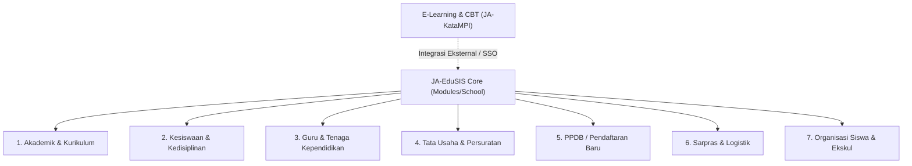

# JA-EduSIS — Overview & Peta Domain Sistem Informasi Sekolah

## 1. Visi Produk

**JA-EduSIS** (*Jejakawan Educational School Information System*) adalah sistem informasi manajemen sekolah terpadu berstandar enterprise. Dibangun di atas fondasi **Jejakawan Core Engine** (`ja-core_engine`), JA-EduSIS menggabungkan ketangguhan keamanan tingkat enterprise (ABAC, RBAC, SIEM, audit log, rate limiter, bot shield) dengan kelengkapan domain operasional sekolah modern di Indonesia.

Sistem ini didesain modular, multi-jenjang (SMK, SMA, SMP, SD, Madrasah), patuh pada format data **Dapodik Kemendikbudristek**, serta siap melayani kebutuhan administratif harian guru, staf tata usaha, wali kelas, konselor BK, siswa, dan orang tua murid.

---

## 2. Peta Sub-Domain EduSIS

Sistem EduSIS dipecah ke dalam 7 sub-domain utama di dalam modul `Modules/School`:

### 1. Akademik & Kurikulum (`sch_acad_*`)
- **Master Data**: Tahun Ajaran, Semester (Ganjil/Genap), Jurusan / Konsentrasi Keahlian, Rombel / Kelas (`StudyGroup`), dan Mata Pelajaran (`Subject`).
- **Penjadwalan**: Matriks jadwal KBM mingguan per kelas dan per guru.
- **Jurnal KBM Guru**: Pencatatan materi yang diajarkan, siswa yang tidak hadir, catatan KBM harian, dan bukti foto kegiatan.
- **Penilaian & Raport**: Penilaian berbasis Kurikulum Merdeka dan Kurikulum 2013 (Nilai Formatif, Sumatif, Pengetahuan, Keterampilan, Proyek P5, Portofolio, Predikat, dan Deskripsi Capaian Kompetensi).
- **Riwayat Kelas**: Pencatatan jejak historis kenaikan kelas dan pemindahan rombel siswa.

### 2. Kesiswaan & Kedisiplinan (`sch_std_*`)
- **Buku Induk Siswa**: Profil siswa standar Dapodik (NISN, NIS, NIK, alamat lengkap, kontak, data detail Ayah, Ibu, dan Wali murid).
- **Sistem Poin Kredit Perilaku**: Pelanggaran berbobot minus dan prestasi berbobot plus dengan ambang batas akumulasi untuk penerbitan Surat Peringatan (SP1, SP2, SP3) otomatis.
- **Bimbingan Konseling (BK)**: Manajemen sesi konseling privat (`is_confidential`), pencatatan intervensi masalah, tindak lanjut, dan flag kasus mendesak.
- **Presensi Siswa**: Kehadiran harian berbasis status (Hadir, Izin, Sakit, Alpa) dengan dukungan QR Code scanner dan verifikasi surat sakit.
- **Alumni & Tracer Study**: Pendataan kelulusan, penelusuran tamatan (kuliah, kerja, wirausaha), dan survei alumni.

### 3. Guru & Tenaga Kependidikan / HR (`sch_hr_*`)
- **Data Induk Pendidik & Tendik**: Profil lengkap guru/staf, NIP/NUPTK, pangkat/golongan, dan status kepegawaian.
- **Presensi Staff**: Check-in / check-out presensi harian guru dan staf.
- **Manajemen Cuti & Shift**: Pengajuan izin/cuti pegawai dengan alur approval kepala sekolah / pimpinan TU.
- **Payroll & Struktur Gaji**: Komponen gaji pokok, tunjangan jabatan, potongan absensi, dan penerbitan slip gaji.

### 4. Tata Usaha & Persuratan (`sch_ops_*`)
- **Buku Agenda Persuratan**: Surat Masuk dan Surat Keluar berpenomoran otomatis.
- **Alur Disposisi & Approval**: Distribusi surat masuk kepada pihak terkait dengan arahan disposisi pimpinan.
- **Template Surat**: Template dinamis untuk surat keterangan siswa aktif, surat rekomendasi, surat panggilan orang tua, dll.
- **Buku Tamu / Visitor Log**: Pencatatan tamu sekolah, keperluan kunjungan, dan nomor identitas di pos satpam / lobi resepsionis.

### 5. PPDB / Penerimaan Siswa Baru (`sch_adm_*`)
- **Formulir Pendaftaran Publik**: Portal pendaftaran calon siswa baru secara online.
- **Verifikasi Dokumen**: Unggah dokumen persyaratan (Kartu Keluarga, Ijazah/SKL, Akta Kelahiran, Rapor) dan validasi kelayakan oleh panitia PPDB.
- **Hasil Seleksi & Daftar Ulang**: Pengumuman hasil seleksi jalur zonasi, prestasi, afirmasi, atau tes masuk, dilanjutkan daftar ulang.

### 6. Sarana Prasarana / Sarpras (`sch_fac_*`)
- **Data Fasilitas Fisik**: Gedung, blok ruangan, laboratorium, perpustakaan, asrama, dan kendaraan sekolah.
- **Inventaris Ruangan**: Pendataan aset dan barang inventaris per ruangan beserta kondisinya (baik, rusak ringan, rusak berat).
- **Tiket Pemeliharaan**: Pelaporan kerusakan fasilitas oleh guru/staf dan pelacakan perbaikan oleh tim sarpras.

### 7. Organisasi Siswa & Ekstrakurikuler (`sch_osis_*`)
- **Kepengurusan OSIS**: Struktur organisasi, program kerja, dan laporan realisasi keuangan program OSIS.
- **E-Voting OSIS**: Pemilihan umum ketua dan wakil ketua OSIS secara transparan via sistem.
- **Ekstrakurikuler**: Pendaftaran anggota ekskul, jadwal latihan, dan rekap absensi ekskul.

---

## 3. Batas Lingkup: LMS & CBT Terpisah

> [!IMPORTANT]
> **Keputusan Arsitektur**: EduSIS **TIDAK** mengimplementasikan mesin CBT (Computer-Based Test) dan LMS berat di dalam codebase internalnya.
> Seluruh kebutuhan ujian berbasis komputer (CBT) dan e-learning interaktif didelegasikan ke engine khusus **`ja-katampi`** (yang di-host pada kluster terdedikasi `ja-aksara`).
> Integrasi antar EduSIS dan KataMPI akan dilakukan melalui API sinkronisasi data siswa/kelas dan Single Sign-On (SSO).
